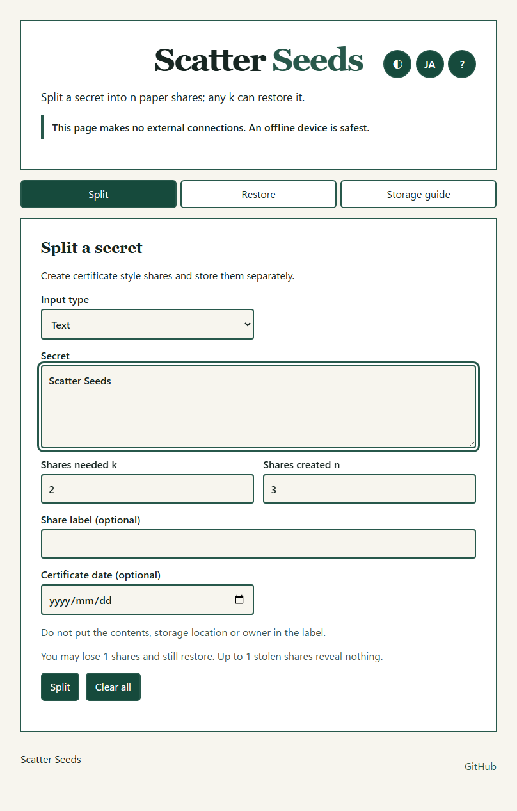
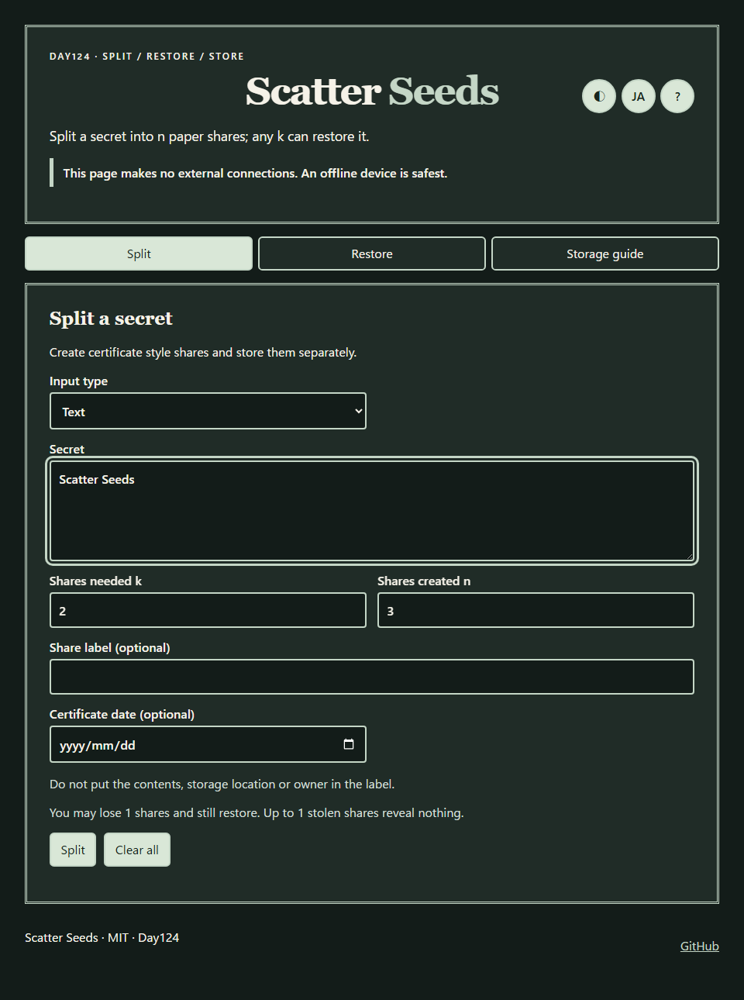
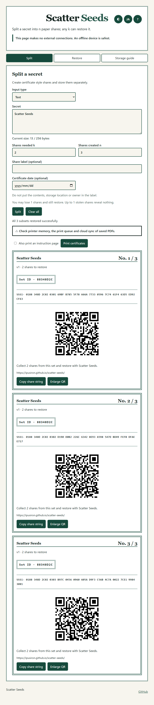
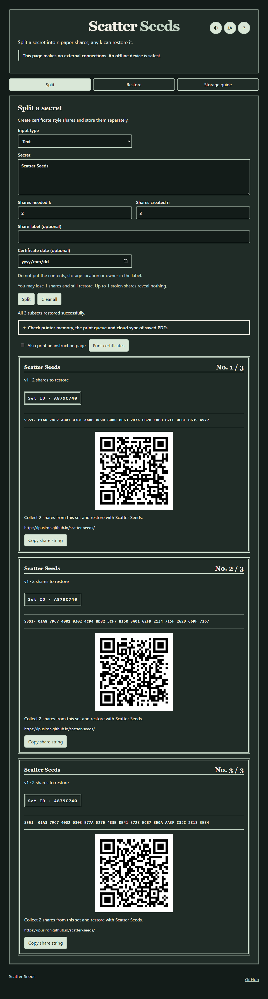
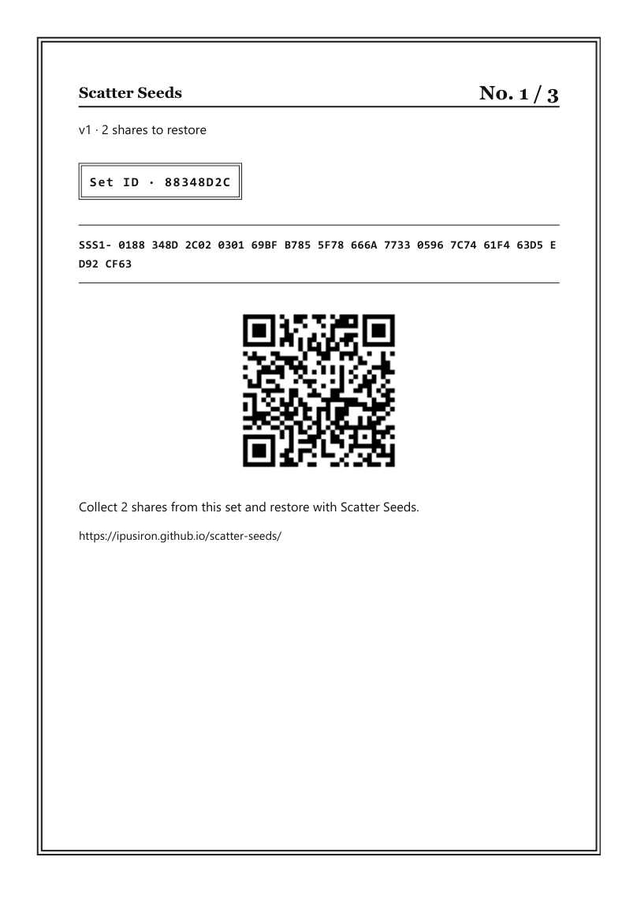
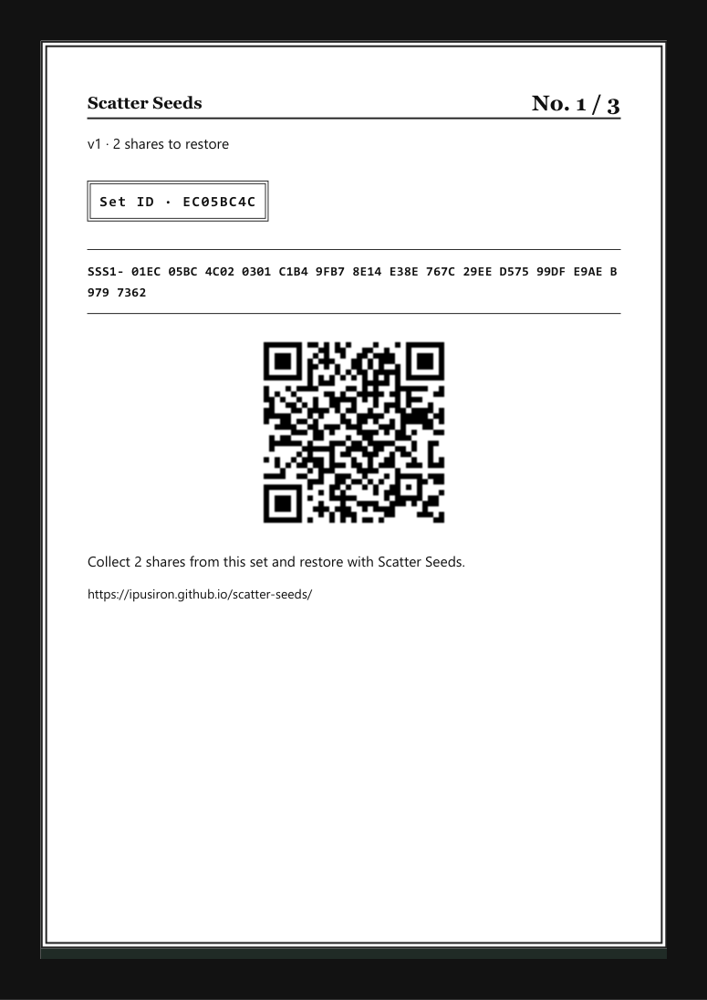
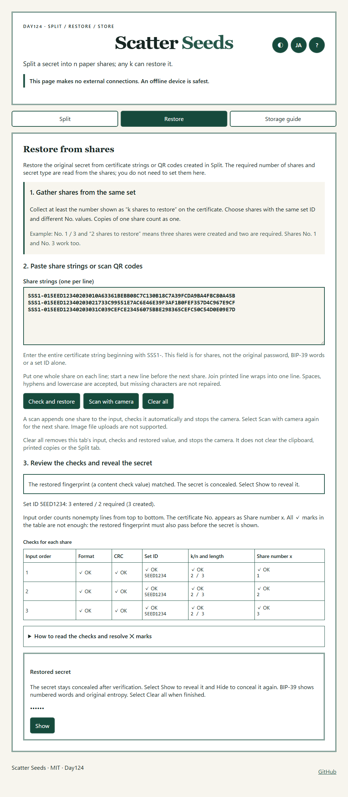
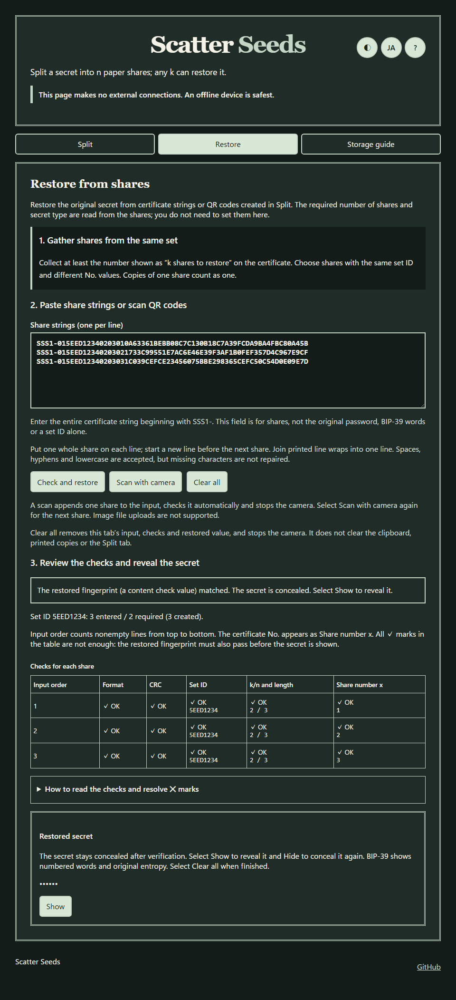
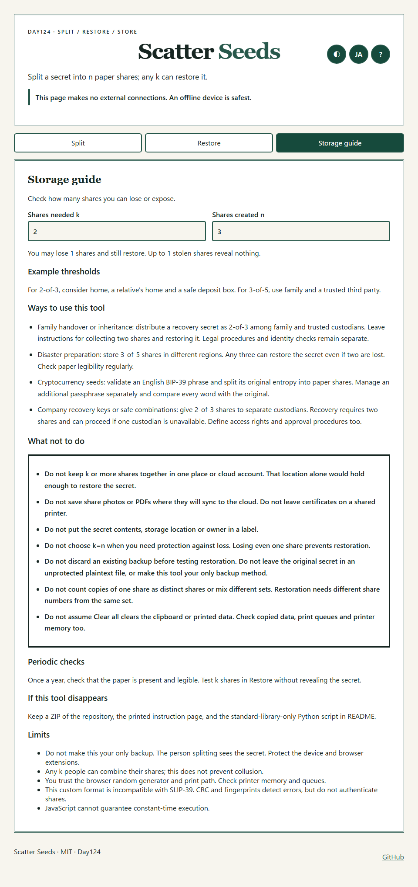
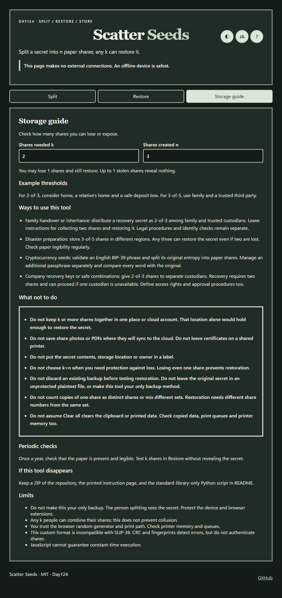

English · [日本語](README.md)

# Scatter Seeds - Split secrets into paper shares


[](https://ipusiron.github.io/scatter-seeds/)

**Day124 - 200 Security Tools with Generative AI**

Scatter Seeds is a tool for splitting a secret into n paper shares with Shamir secret sharing and restoring it from any k shares. It accepts passwords, cryptocurrency seed phrases, safe combinations and recovery keys. Any k−1 shares reveal no information about the secret; up to n−k shares may be lost. Before displaying the shares, it checks that every k-share subset restores the original secret.

The name evokes scattering and planting shares as seeds, a cryptocurrency seed, and stocking seeds for future needs. Its initials also match Shamir's Secret Sharing. SSS is used for Secret Sharing Scheme in general, including the VSSS abbreviation for visual cryptography.

---

## 🌐 Demo

👉 **[Open Scatter Seeds](https://ipusiron.github.io/scatter-seeds/)**

The downloaded `index.html` also works through `file://`. The page makes no external connections. Use a trusted offline device when entering a real secret.

---

## 📸 Screenshots

| State | Light | Dark |
|---|---|---|
| Split |  |  |
| Share certificates |  |  |
| Print preview |  |  |
| Restore and checks |  |  |
| Storage guide |  |  |

The [Japanese README](README.md) shows the same states. Screenshots use only the demo value in `test/fixtures/vectors.json`. Random coefficients and set IDs change between captures.

## ✨ Features

| Tab | What it does |
|---|---|
| Split | Split text, hexadecimal bytes or English BIP-39 with 2≤k≤n≤16. Display the shares and QR codes only after checking every threshold subset. Print one A4 certificate per share. |
| Restore | Paste one share string per line or start the camera to scan one QR code. Check the format, CRC, set ID, k/n, x, fingerprint and extra shares. The restored secret is initially concealed. |
| Storage guide | Calculate how many shares may be lost or exposed and read storage examples, inspection advice and limits. |

Secrets, shares and labels are never stored in browser storage, URLs or history. Only language and theme are saved. Clear all clears the screen, but cannot clear the clipboard after a copy.

## 📖 How to use

### Threshold sharing: any k of n shares

A secret and random values create n shares; any k distinct shares can restore the original secret. The required number k is the threshold. With n=3, k=2 (2-of-3), shares 1+2, 1+3 or 2+3 all work. One share may be lost, and two copies of the same share still count as only one.

With correct randomness, k−1 or fewer shares alone reveal nothing about the secret value. Shares are not slices of the original text. They still reveal metadata such as length, k and n. You may lose n−k shares and still restore, but k=n makes the loss of even one share fatal to recovery.

[Day123 ShamirSharing CipherLab](https://ipusiron.github.io/shamir-sharing-cipherlab/) explains the mechanism using coordinate plots, worked calculations and byte tables. It puts the required number first in the notation “(k,n) threshold sharing”. Day123 is educational: use practice values, never real passwords or seed phrases.

### Steps

The “?” button opens help with each tab, a practice exercise, use cases and what not to do. Values chosen in Storage guide do not change the settings in Split. Start by splitting the nonsecret text “Scatter Seeds” with k=2, n=3 and testing restoration.

1. Open the page on an offline device. Enter text, an even number of hex digits, or complete English BIP-39 words. Text is encoded as UTF-8 without normalization. The limit is 256 bytes.
2. Choose k and n. With 2-of-3, one share may be lost and one stolen share reveals no information. With k=n, losing even one share prevents restoration.
3. Optionally enter a label of up to 40 characters and a date. Do not put the contents, storage location or owner on the label.
4. Press Split. Shares appear only after all k-share subsets have been checked. Print each certificate separately and store it in a different place. Check printer memory, print queues and cloud sync for saved PDFs.
5. To restore, paste at least k distinct shares from the same set, one per line, or scan them one by one. The camera stops after each scan; select Scan with camera again for the next share. Review the table and messages, then select Show to see the restored secret.

English BIP-39 accepts 12, 15, 18, 21 or 24 words. Input is normalized with NFKD, lowercasing and whitespace cleanup, then checked against the word list and checksum. Four-letter abbreviations are rejected. The checksum has only 4–8 bits: with 12 words, a wrong word can still pass about 1 in 16 times. Compare every word with the source paper. The 25th passphrase is outside this tool and must be stored separately. Restoration shows numbered words and the original entropy in hex.

## 🔬 Format v1 and calculations

The string is `SSS1-` followed by uppercase hex. Spaces, hyphens, line breaks and lowercase letters are tolerated when parsing; no automatic correction occurs. A share contains these bytes in order:

| Field | Length | Meaning |
|---|---:|---|
| Version | 1 byte | `01` |
| Set ID | 4 bytes | Random identifier for grouping shares. |
| k, n, x | 1 byte each | `2≤k≤n≤16` and `1≤x≤n`; x=0 is rejected. |
| Share data | Secret length + 5 bytes | Each byte of `type ‖ S ‖ fingerprint` is shared with a separate polynomial. |
| CRC-32 | 4 bytes | IEEE CRC-32 over all preceding bytes; `123456789`→`CBF43926`. |

Types are `01` for UTF-8 text, `02` for bytes and `03` for original BIP-39 entropy. The fingerprint is the first four bytes of `SHA-256(type ‖ S)`. Type and fingerprint are shared together with the secret. The field is GF(2⁸), with irreducible polynomial `0x11B` and XOR addition. Coefficients and the set ID come only from `crypto.getRandomValues`. String length is `5 + 2 × (secret bytes + 17)` characters.

| Secret length | Share characters | Alphanumeric QR version, error correction M |
|---:|---:|---:|
| 16 bytes | 71 | 4 |
| 32 bytes | 103 | 5 |
| 64 bytes | 167 | 7 |
| 128 bytes | 295 | 10 |
| 256 bytes | 551 | 15 |

CRC catches transcription errors. A fingerprint mismatch stops secret display. If more than k shares are supplied, the tool identifies extra shares that do not lie on the polynomial defined by the first k. A random 32-bit set ID can collide. CRC and the four-byte fingerprint are not authentication tags; they cannot prevent deliberate rewriting by an attacker who has k shares.

## 🐍 Restore without the tool

Keep a repository ZIP, the printed instruction page and `test/fixtures/bip39-english.txt` separately from the shares. Save the code below as `restore.py` and run it offline with Python 3.10 or later. It uses only the standard library. Feed one complete share per stdin line; it prints no secret until checks pass. Do not put shares directly in your shell history.

```python
"""Restore Scatter Seeds v1 shares from stdin using only Python's standard library.

Run offline: python restore.py < shares.txt
One complete SSS1 share per line. No data is written to disk.
"""
import hashlib
import sys
import zlib
from pathlib import Path


def mul(a, b):
    result = 0
    for _ in range(8):
        if b & 1:
            result ^= a
        a = ((a << 1) ^ (0x11B if a & 0x80 else 0)) & 255
        b >>= 1
    return result


def inverse(a):
    if not a:
        raise ValueError('zero denominator')
    result = 1
    for _ in range(254):
        result = mul(result, a)
    return result


def parse(raw):
    value = ''.join(c for c in raw.upper() if not c.isspace() and c != '-')
    if not value.startswith('SSS1'):
        raise ValueError('prefix')
    try:
        data = bytes.fromhex(value[4:])
    except ValueError as error:
        raise ValueError('hex') from error
    if not 18 <= len(data) <= 273:
        raise ValueError('length')
    body, crc = data[:-4], int.from_bytes(data[-4:], 'big')
    if zlib.crc32(body) != crc:
        raise ValueError('CRC')
    if body[0] != 1:
        raise ValueError('version')
    set_id, k, n, x, part = body[1:5], body[5], body[6], body[7], body[8:]
    if x == 0 or not 2 <= k <= n <= 16 or x > n:
        raise ValueError('threshold or x')
    return set_id, k, n, x, part


def interpolate(points, at):
    result = bytearray(len(points[0][1]))
    for i, (xi, data) in enumerate(points):
        numerator = denominator = 1
        for j, (xj, _) in enumerate(points):
            if i != j:
                numerator = mul(numerator, at ^ xj)
                denominator = mul(denominator, xi ^ xj)
        weight = mul(numerator, inverse(denominator))
        for pos, value in enumerate(data):
            result[pos] ^= mul(weight, value)
    return bytes(result)


def restore(lines):
    shares = [parse(line) for line in lines if line.strip()]
    if not shares:
        raise ValueError('no shares')
    set_id, k, n, _, data = shares[0]
    if len(shares) < k:
        raise ValueError(f'need {k - len(shares)} more shares')
    if len(shares) > n:
        raise ValueError('too many shares')
    xs = set()
    for sid, ki, ni, x, part in shares:
        if sid != set_id or ki != k or ni != n or len(part) != len(data):
            raise ValueError('mixed shares')
        if x in xs:
            raise ValueError('duplicate x')
        xs.add(x)
    basis = [(x, part) for _, _, _, x, part in shares[:k]]
    combined = interpolate(basis, 0)
    kind, secret, fingerprint = combined[0], combined[1:-4], combined[-4:]
    if kind not in (1, 2, 3) or hashlib.sha256(bytes([kind]) + secret).digest()[:4] != fingerprint:
        raise ValueError('fingerprint mismatch')
    outside = [x for _, _, _, x, part in shares[k:] if interpolate(basis, x) != part]
    return kind, secret, outside


def mnemonic(entropy):
    if len(entropy) not in (16, 20, 24, 28, 32):
        raise ValueError('BIP-39 entropy length')
    source = Path(__file__).resolve().parent / 'test' / 'fixtures' / 'bip39-english.txt'
    word_data = source.read_bytes()
    if hashlib.sha256(word_data).hexdigest() != '2f5eed53a4727b4bf8880d8f3f199efc90e58503646d9ff8eff3a2ed3b24dbda':
        raise ValueError('BIP-39 word list checksum')
    words = word_data.decode('utf-8').split()
    if len(words) != 2048:
        raise ValueError('BIP-39 word list length')
    bits = ''.join(f'{byte:08b}' for byte in entropy)
    bits += ''.join(f'{byte:08b}' for byte in hashlib.sha256(entropy).digest())[:len(entropy) // 4]
    return ' '.join(words[int(bits[i:i + 11], 2)] for i in range(0, len(bits), 11))


def safe_text(value):
    return ''.join(f'\\u{ord(char):04X}' if ord(char) < 32 or 0x7F <= ord(char) <= 0x9F or
                   0x202A <= ord(char) <= 0x202E or 0x2066 <= ord(char) <= 0x2069 else char
                   for char in value)


def main():
    try:
        kind, secret, outside = restore(sys.stdin)
        if kind == 1:
            output = safe_text(secret.decode('utf-8', errors='strict'))
        elif kind == 2:
            output = secret.hex().upper()
        else:
            output = mnemonic(secret) + '\nEntropy (hex): ' + secret.hex().upper()
    except (ValueError, UnicodeError, OSError) as error:
        print('Restore failed:', error, file=sys.stderr)
        return 1
    if outside:
        print('Inconsistent extra shares: ' + ', '.join(map(str, outside)), file=sys.stderr)
    print(output)
    return 0


if __name__ == '__main__':
    raise SystemExit(main())
```

To recover English BIP-39 words, place the word list in its repository location. The script checks its SHA-256. For each byte, Lagrange interpolation of the points `(x, y)` obtains `f(0)`, then the fingerprint of the restored `type ‖ S ‖ fingerprint` is checked.

## 🔄 Related tools and prior art

| Aspect | Scatter Seeds | Related tool or prior art |
|---|---|---|
| Purpose | A practical paper backup and restoration tool for real secrets | [Day123 ShamirSharing CipherLab](https://ipusiron.github.io/shamir-sharing-cipherlab/) teaches GF(p), GF(2⁸) and pitfalls. |
| Method | Shamir secret sharing only | [Day070 VisualCryptography CipherLab](https://ipusiron.github.io/visual-cryptography-cipherlab/) teaches overlay-based visual cryptography. |
| Paper and QR | Custom format with k, set ID, CRC and all-subset checks | [Banana Split](https://github.com/paritytech/banana_split) wraps a secret before splitting it for paper and QR. |
| Checks | Fingerprint and checks of extra shares | [secrets.js](https://github.com/grempe/secrets.js), Vault and ssss have different designs and formats. |
| Tool loss | Printable instructions and a standard-library-only Python script | The user can retain an independent recovery method. |

The prior-art search is limited. This custom format is incompatible with SLIP-39 devices.

## 🎯 Use cases

Ways of using this tool in particular:

- Inheritance preparation: make 2-of-3 shares and give them separately to family and a professional. One may be lost while two still recover the secret. This does not replace legal procedures or identity checks.
- Disaster recovery: put a company's 3-of-5 recovery key in different regions. Losing two still leaves three for restoration. Check legibility regularly.
- Cryptocurrency seed: validate an English 24-word BIP-39 phrase and split its original 32 bytes. A share has 103 characters and QR version 5. Keep the 25th passphrase separately.
- Safe combination: split a short text as 2-of-3 and print it after all-subset checks. Manage the right to open the safe separately.

## 🔒 Storage and limits

### What not to do

- Do not keep k or more shares together in one place or cloud account. That location alone would hold enough to restore the secret.
- Do not save share photos or PDFs where they will sync to the cloud. Do not leave certificates on a shared printer.
- Do not put the secret contents, storage location or owner in a label.
- Do not choose k=n when you need protection against loss. Losing even one share prevents restoration.
- Do not discard an existing backup before testing restoration. Do not leave the original secret in an unprotected plaintext file, or make this tool your only backup method.
- Do not count copies of one share as distinct shares or mix different sets. Restoration needs different share numbers from the same set.
- Do not assume Clear all clears the clipboard or printed data. Check copied data, print queues and printer memory too.

### Checks and limits

Once a year, check that the paper is present and legible. Test k shares in Restore without pressing Show. The person splitting sees the secret. The tool cannot prevent collusion by holders of k shares or issues with the device, extensions and print path. It trusts browser randomness. JavaScript cannot guarantee constant-time execution. CRC and fingerprints help find errors and inconsistencies; they do not authenticate the creator or guarantee that deliberate changes are absent.

The author does not encourage misuse.

## 🧪 Tests

Run `npm test` with Node 22 or later; there are no packages to install. It checks all 65,536 GF(2⁸) multiplication pairs, 255 inverses, three reference share sets, official BIP-39 values, CRC, fingerprints, extra shares, all threshold subsets, QR versions, CSP, copied-file hashes and the README Python script. `python test/interface.browser.py` checks Chromium and Firefox on `file://` at 320/390/1280px, printing, restoration and camera behavior. The browser test needs Python Playwright, pypdf and ffmpeg. GitHub Actions runs the Node tests on pushes and PRs.

## 📁 Directory structure

```text
scatter-seeds/                       # Tool root
├── index.html                       # Three-tab interface and CSP
├── style.css                        # Screen and print certificate styling
├── app.js                           # Inputs, verification, restoration, camera
├── sss-core.js                      # GF(2⁸), share v1, CRC, restoration
├── sha256-core.js                   # Day118 SHA-256 implementation
├── bip39.js                         # BIP-39 validation and conversion
├── bip39-english.js                 # 2,048 English words
├── qr.js                            # QR generation and scanning adapter
├── messages.js                      # Japanese and English copy
├── restore.py                       # Independent Python restoration script
├── README.md                        # Japanese documentation
├── README.en.md                     # English documentation
├── LICENSE                          # MIT license
├── package.json                     # Node test configuration
├── vendor/                          # QR libraries and license texts
│   ├── qrcode.min.js                # qrcode-generator 1.4.4
│   ├── jsQR.js                       # Video frame QR decoder
│   ├── LICENSE-qrcode-generator.txt # qrcode-generator license
│   └── LICENSE-jsQR.txt             # jsQR license
├── test/                            # Node and browser tests
│   ├── core.test.js                 # Reference values and arithmetic
│   ├── static.test.js               # CSP and bundled files
│   ├── contrast.test.js             # Light and dark text contrast
│   ├── format.test.js               # Readable source line counts and lengths
│   ├── readme.test.js               # README and Python restoration
│   ├── interface.browser.py         # file:// measurements
│   └── fixtures/                    # Pinned reference data
│       ├── vectors.json             # Share, BIP-39 and QR vectors
│       └── bip39-english.txt        # English BIP-39 word list
├── assets/                          # README screenshots
│   ├── ja/                          # Japanese interface
│   │   ├── light/                   # Japanese light theme
│   │   │   ├── split.png            # Split form
│   │   │   ├── shares.png           # Share certificates
│   │   │   ├── print.png            # Print preview
│   │   │   ├── restore.png          # Restore checks
│   │   │   └── guide.png            # Storage guide
│   │   └── dark/                    # Japanese dark theme
│   │       ├── split.png            # Split form
│   │       ├── shares.png           # Share certificates
│   │       ├── print.png            # Print preview
│   │       ├── restore.png          # Restore checks
│   │       └── guide.png            # Storage guide
│   └── en/                          # English interface
│       ├── light/                   # English light theme
│       │   ├── split.png            # Split form
│       │   ├── shares.png           # Share certificates
│       │   ├── print.png            # Print preview
│       │   ├── restore.png          # Restore checks
│       │   └── guide.png            # Storage guide
│       └── dark/                    # English dark theme
│           ├── split.png            # Split form
│           ├── shares.png           # Share certificates
│           ├── print.png            # Print preview
│           ├── restore.png          # Restore checks
│           └── guide.png            # Storage guide
└── .github/                         # GitHub Actions
    └── workflows/                   # CI workflow
        └── test.yml                 # Node 22 test job
```

Each theme under `assets` contains `split.png`, `shares.png`, `print.png`, `restore.png` and `guide.png`.

## 💻 Environment

This vanilla JavaScript tool uses ordinary scripts, with no build or network connection. It works on `file://` and GitHub Pages. Camera permission is required; if unavailable, use the GitHub Pages version or paste share strings.

## 📄 License

- The tool itself is under the [MIT License](LICENSE).
- [qrcode-generator](vendor/LICENSE-qrcode-generator.txt) and [jsQR](vendor/LICENSE-jsQR.txt) use their bundled license texts.
- The English BIP-39 word list comes from MIT-licensed [bitcoin/bips](https://github.com/bitcoin/bips/blob/master/bip-0039/english.txt).

---

## 🛠️ About this tool

This tool was developed as part of the "200 Security Tools with Generative AI" project. The project builds and publishes a variety of security-related tools over 100 days with AI assistance.

🔗 [https://akademeia.info/?page_id=44607](https://akademeia.info/?page_id=44607)
