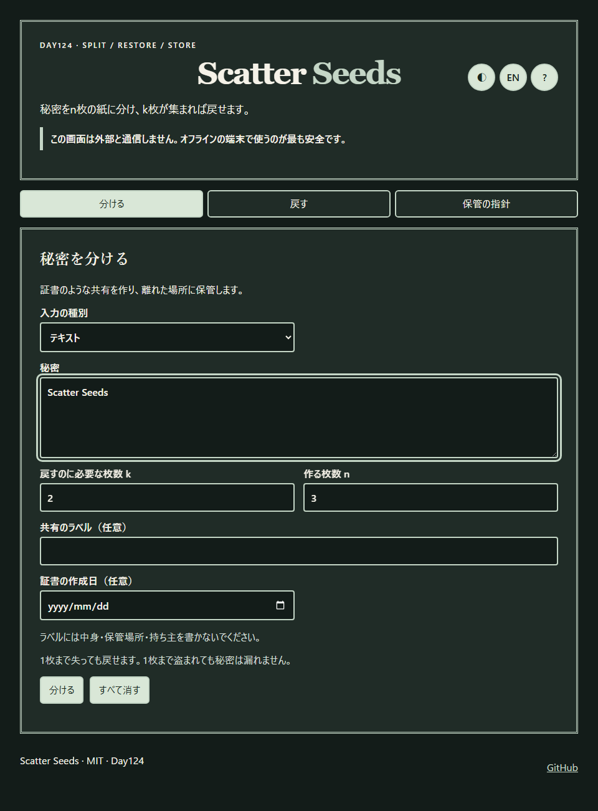
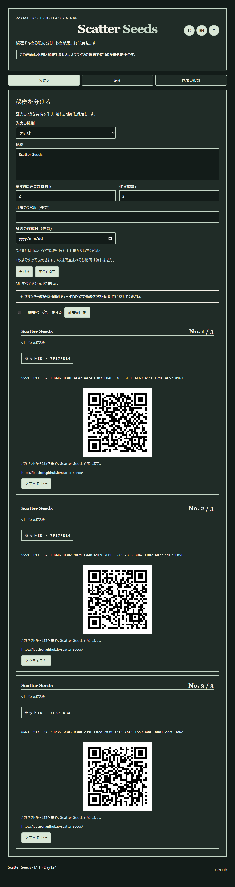
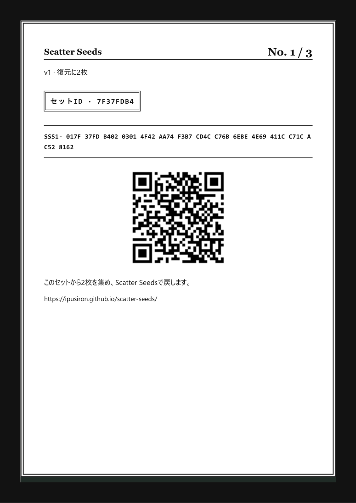
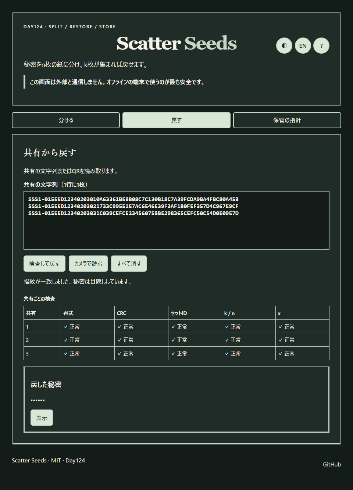
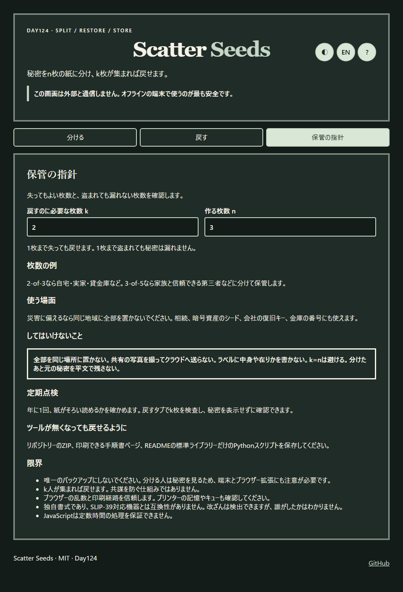

<!--
---
id: day124
slug: scatter-seeds
title: "Scatter Seeds"
subtitle_ja: "秘密を紙の共有に分けて備える"
subtitle_en: "Split a secret into paper shares for recovery"
description_ja: "シャミアの秘密分散で秘密を分け、全組を検査して証書として印刷し、QRまたは文字列から復元するツール。"
description_en: "Split secrets with Shamir sharing, verify every threshold subset, print certificates, and restore by QR or text."
category_ja:
  - プレッパー
  - 現代暗号
  - 物理的セキュリティ
category_en:
  - Prepping / Survival
  - Modern Cryptography
  - Physical Security
difficulty: 3
tags:
  - shamir
  - secret-sharing
  - bip39
  - paper-backup
  - qr-code
repo_url: "https://github.com/ipusiron/scatter-seeds"
demo_url: "https://ipusiron.github.io/scatter-seeds/"
hub: true
---
-->

# Scatter Seeds - 秘密を紙の共有に分けて備える

[English](README.en.md) · 日本語


[](https://ipusiron.github.io/scatter-seeds/)

**Day124 - 生成AIで作るセキュリティツール200**

Scatter Seedsは、秘密をシャミアの秘密分散でn枚の紙に分け、k枚から復元するツールです。パスワード、暗号資産のシード、金庫の番号、復旧キーを扱えます。k−1枚から秘密の情報は漏れず、n−k枚を失っても戻せます。共有を作った直後に、すべてのk枚の組が元の秘密を戻すことを検査します。

名前は、共有という「種」を離れた場所へ蒔くことに由来します。暗号資産のシードと、備えのための種の備蓄も重ねています。頭文字SSSはShamir's Secret Sharingとも共通です。Secret Sharing Scheme一般にも使われ、視覚暗号のVSSSにも含まれる略語です。

---

## 🌐 デモページ

👉 **[Scatter Seedsを開く](https://ipusiron.github.io/scatter-seeds/)**

ダウンロードした`index.html`を`file://`で開いても使えます。画面は外部へ通信しません。秘密を入れるときは、オフラインの信頼できる端末を使ってください。

---

## 📸 スクリーンショット

| 状態 | ライト | ダーク |
|---|---|---|
| 分ける |  |  |
| 共有の証書 |  |  |
| 印刷プレビュー |  |  |
| 戻す・検査表 |  |  |
| 保管の指針 |  |  |

[英語画面の同じ状態](README.en.md)も掲載しています。撮影には`test/fixtures/vectors.json`のデモ値だけを使っています。共有の乱数とセットIDは撮影ごとに変わります。

## ✨ できること

| タブ | 内容 |
|---|---|
| 分ける | テキスト、16進のバイト列、英語BIP-39を2≤k≤n≤16で分ける。全組の復元検査が終わってから共有とQRを表示し、A4で1枚ずつ印刷する。 |
| 戻す | 文字列を1行ずつ貼るか、押したときだけカメラでQRを1枚読む。書式、CRC、セットID、k/n、x、指紋、余分な共有の食い違いを検査する。秘密は最初は隠す。 |
| 保管の指針 | kとnから失ってよい枚数と盗まれてよい枚数を示し、保管例、定期点検、限界を説明する。 |

秘密・共有・ラベルはストレージ、URL、履歴に保存しません。保存するのは言語と明暗だけです。「すべて消す」は画面の値を消しますが、コピー先のクリップボードは消せません。

## 📖 使い方

1. オフラインの端末で開き、テキスト、偶数桁の16進、または完全な英語BIP-39の語を入力します。テキストはUTF-8へそのまま変換し、正規化しません。上限は256バイトです。
2. `k`と`n`を選びます。2-of-3なら1枚を失っても戻せ、1枚を盗まれても秘密の情報は漏れません。k=nなら1枚でも失うと戻せません。
3. 必要なら40文字以内のラベルと日付を入れます。ラベルに中身、保管場所、持ち主を書かないでください。
4. 「分ける」を押します。全k枚の組の復元検査が終わるまで共有は表示されません。各証書の文字列とQRを別々に印刷し、離れた場所に保管します。プリンターの記憶、印刷キュー、PDF保存先のクラウド同期にも注意してください。
5. 戻すときはk枚以上を1行に1枚ずつ貼るか、カメラで1枚ずつ読みます。検査表と指紋が通ったら「表示」で秘密を見られます。

BIP-39は12・15・18・21・24語の英語を受け付けます。入力時にNFKD、小文字、空白を整え、語彙とチェックサムを確認します。最初の4文字だけの省略形は受け付けません。チェックサムは4〜8ビットなので、12語では1語を取り違えても約1/16の確率で通ります。元の紙と1語ずつ比べてください。25番目のパスフレーズは扱わないため、別に保管してください。復元結果には番号つきの語と元の乱数の16進を表示します。

## 🔬 書式v1と計算

文字列は`SSS1-`と大文字の16進です。区切りの空白・ハイフン・改行と小文字は読み取り時に許しますが、自動訂正はしません。1枚のバイト列は次の順です。

| フィールド | 長さ | 内容 |
|---|---:|---|
| 版 | 1バイト | `01` |
| セットID | 4バイト | 乱数。共有を同じセットとして扱う目印。 |
| k、n、x | 各1バイト | `2≤k≤n≤16`、`1≤x≤n`。x=0は拒否。 |
| 分散データ | 秘密長＋5バイト | `種別 ‖ S ‖ 指紋`を1バイトずつ独立の多項式で分けた値。 |
| CRC-32 | 4バイト | それ以前の全バイトのIEEE CRC-32。`123456789`→`CBF43926`。 |

種別は`01`がUTF-8テキスト、`02`がバイト列、`03`がBIP-39の元の乱数です。指紋は`SHA-256(種別 ‖ S)`の先頭4バイトです。種別と指紋も秘密とともに分けます。体はGF(2⁸)、既約多項式は`0x11B`、加算はXORです。係数とセットIDには`crypto.getRandomValues`だけを使います。共有の長さは`5＋2×(秘密のバイト数＋17)`文字です。

| 秘密の長さ | 共有の文字数 | QRの版（英数字、誤り訂正M） |
|---:|---:|---:|
| 16バイト | 71 | 4 |
| 32バイト | 103 | 5 |
| 64バイト | 167 | 7 |
| 128バイト | 295 | 10 |
| 256バイト | 551 | 15 |

CRCは書き写しの誤りを見つけます。指紋が一致しなければ値を表示しません。k枚より多いときは、最初のk枚から決まる多項式に乗らない共有のxを示します。セットIDは32ビットなので偶然の衝突はあり得ます。CRCと4バイトの指紋は認証タグではありません。k枚を持つ攻撃者による意図的な作り直しを防ぎません。

## 🐍 ツールを使わずに復元する

リポジトリーのZIP、手順書の印刷、英語BIP-39語彙の`test/fixtures/bip39-english.txt`を共有と別に保管してください。下のコードを`restore.py`として保存し、オフライン端末のPython 3.10以降で実行できます。標準ライブラリーだけを使います。共有は標準入力から1行ずつ渡し、検査が通るまでは秘密を出しません。コマンド履歴に共有を直接書かないでください。

```python
"""Restore Scatter Seeds v1 shares from stdin using only Python's standard library.

Run offline: python restore.py < shares.txt
One complete SSS1 share per line. No data is written to disk.
"""
import hashlib
import sys
import zlib
from pathlib import Path


def mul(a, b):
    result = 0
    for _ in range(8):
        if b & 1:
            result ^= a
        a = ((a << 1) ^ (0x11B if a & 0x80 else 0)) & 255
        b >>= 1
    return result


def inverse(a):
    if not a:
        raise ValueError('zero denominator')
    result = 1
    for _ in range(254):
        result = mul(result, a)
    return result


def parse(raw):
    value = ''.join(c for c in raw.upper() if not c.isspace() and c != '-')
    if not value.startswith('SSS1'):
        raise ValueError('prefix')
    try:
        data = bytes.fromhex(value[4:])
    except ValueError as error:
        raise ValueError('hex') from error
    if not 18 <= len(data) <= 273:
        raise ValueError('length')
    body, crc = data[:-4], int.from_bytes(data[-4:], 'big')
    if zlib.crc32(body) != crc:
        raise ValueError('CRC')
    if body[0] != 1:
        raise ValueError('version')
    set_id, k, n, x, part = body[1:5], body[5], body[6], body[7], body[8:]
    if x == 0 or not 2 <= k <= n <= 16 or x > n:
        raise ValueError('threshold or x')
    return set_id, k, n, x, part


def interpolate(points, at):
    result = bytearray(len(points[0][1]))
    for i, (xi, data) in enumerate(points):
        numerator = denominator = 1
        for j, (xj, _) in enumerate(points):
            if i != j:
                numerator = mul(numerator, at ^ xj)
                denominator = mul(denominator, xi ^ xj)
        weight = mul(numerator, inverse(denominator))
        for pos, value in enumerate(data):
            result[pos] ^= mul(weight, value)
    return bytes(result)


def restore(lines):
    shares = [parse(line) for line in lines if line.strip()]
    if not shares:
        raise ValueError('no shares')
    set_id, k, n, _, data = shares[0]
    if len(shares) < k:
        raise ValueError(f'need {k - len(shares)} more shares')
    if len(shares) > n:
        raise ValueError('too many shares')
    xs = set()
    for sid, ki, ni, x, part in shares:
        if sid != set_id or ki != k or ni != n or len(part) != len(data):
            raise ValueError('mixed shares')
        if x in xs:
            raise ValueError('duplicate x')
        xs.add(x)
    basis = [(x, part) for _, _, _, x, part in shares[:k]]
    combined = interpolate(basis, 0)
    kind, secret, fingerprint = combined[0], combined[1:-4], combined[-4:]
    if kind not in (1, 2, 3) or hashlib.sha256(bytes([kind]) + secret).digest()[:4] != fingerprint:
        raise ValueError('fingerprint mismatch')
    outside = [x for _, _, _, x, part in shares[k:] if interpolate(basis, x) != part]
    return kind, secret, outside


def mnemonic(entropy):
    if len(entropy) not in (16, 20, 24, 28, 32):
        raise ValueError('BIP-39 entropy length')
    source = Path(__file__).resolve().parent / 'test' / 'fixtures' / 'bip39-english.txt'
    word_data = source.read_bytes()
    if hashlib.sha256(word_data).hexdigest() != '2f5eed53a4727b4bf8880d8f3f199efc90e58503646d9ff8eff3a2ed3b24dbda':
        raise ValueError('BIP-39 word list checksum')
    words = word_data.decode('utf-8').split()
    if len(words) != 2048:
        raise ValueError('BIP-39 word list length')
    bits = ''.join(f'{byte:08b}' for byte in entropy)
    bits += ''.join(f'{byte:08b}' for byte in hashlib.sha256(entropy).digest())[:len(entropy) // 4]
    return ' '.join(words[int(bits[i:i + 11], 2)] for i in range(0, len(bits), 11))


def safe_text(value):
    return ''.join(f'\\u{ord(char):04X}' if ord(char) < 32 or 0x7F <= ord(char) <= 0x9F or
                   0x202A <= ord(char) <= 0x202E or 0x2066 <= ord(char) <= 0x2069 else char
                   for char in value)


def main():
    try:
        kind, secret, outside = restore(sys.stdin)
        if kind == 1:
            output = safe_text(secret.decode('utf-8', errors='strict'))
        elif kind == 2:
            output = secret.hex().upper()
        else:
            output = mnemonic(secret) + '\nEntropy (hex): ' + secret.hex().upper()
    except (ValueError, UnicodeError, OSError) as error:
        print('Restore failed:', error, file=sys.stderr)
        return 1
    if outside:
        print('Inconsistent extra shares: ' + ', '.join(map(str, outside)), file=sys.stderr)
    print(output)
    return 0


if __name__ == '__main__':
    raise SystemExit(main())
```

英語BIP-39を元の語へ戻すときは、上記語彙ファイルを同じリポジトリー内の位置に置きます。スクリプトは語彙のSHA-256も確認します。計算の要点は、各バイトの点`(x, y)`からラグランジュ補間で`f(0)`を求め、復元した`種別 ‖ S ‖ 指紋`の指紋を検査することです。

## 🔄 関連ツールと先行例

| 観点 | Scatter Seeds | 関連ツール・先行例 |
|---|---|---|
| 目的 | 本物の秘密を紙に分けて保管し、復元を確認する道具 | [Day123 ShamirSharing CipherLab](https://ipusiron.github.io/shamir-sharing-cipherlab/)はGF(p)・GF(2⁸)と落とし穴を学ぶ教材。 |
| 方式 | シャミアの秘密分散だけ | [Day070 VisualCryptography CipherLab](https://ipusiron.github.io/visual-cryptography-cipherlab/)は画像を重ねる視覚暗号の教材。 |
| 紙とQR | k・セットID・CRCを含む独自書式で、全組を復元検査 | [Banana Split](https://github.com/paritytech/banana_split)は秘密を包んで紙とQRへ分ける。 |
| 検査 | 指紋で食い違いを検出し、余分な共有も検査 | [secrets.js](https://github.com/grempe/secrets.js)・Vault・ssssは設計や書式が異なる。 |
| ツール消失への備え | 印刷用手順書と標準ライブラリーだけのPythonスクリプト | 利用者が手順を手元に残せる。 |

調査範囲は限られます。独自書式はSLIP-39対応機器と互換性がありません。

## 🎯 ユースケース

このツールならではの使い方：

- 相続の備え：本人が2-of-3を作り、家族と専門家に別々の共有を渡す。1枚を失っても2枚で戻せます。相続手続きや本人確認の代わりにはなりません。
- 災害時の復旧：事業の復旧キーを3-of-5にし、異なる地域へ置く。2枚が失われても3枚で戻せます。定期的に紙の可読性を確かめます。
- 暗号資産のシード：英語BIP-39の24語を検証して元の32バイトを分ける。共有は103文字、QRは版5です。25番目のパスフレーズは別に保管します。
- 金庫の番号：短いテキストを2-of-3にして分ける。全組の検査後に印刷します。金庫を開ける権限は別に管理します。

## 🔒 保管と限界

共有を全部同じ場所へ置かず、写真に撮ってクラウドへ送らないでください。年に1回、k枚を戻すタブで検査し、秘密は表示せずに点検できます。唯一のバックアップにはしないでください。分ける人は元の秘密を見ます。k人の共謀、端末・拡張機能・印刷経路の問題は防げません。乱数はブラウザーを信頼します。JavaScriptは定数時間の実行を保証できません。改ざんには気づけますが、誰が改ざんしたかはわかりません。

作者は悪用を勧めません。

## 🧪 テスト

Node 22以降で`npm test`を実行します。追加パッケージはありません。GF(2⁸)の65,536通りの掛け算、255個の逆元、参照共有3件、BIP-39公式値、CRC・指紋・余分な共有、全k枚の組、QR版、CSPと同梱ファイルのハッシュ、READMEのPythonスクリプトを検査します。`python test/interface.browser.py`はPlaywrightのChromiumとFirefoxで`file://`、320/390/1280px、印刷、復元、カメラを確認します。ブラウザーテストにはPython Playwright・pypdf・ffmpegが必要です。GitHub ActionsはpushとPRでNodeテストを実行します。

## 📁 ディレクトリー構造

```text
scatter-seeds/                       # ツール本体
├── index.html                       # 3タブの画面とCSP
├── style.css                        # 証書の画面・印刷スタイル
├── app.js                           # 入力、全組検査、復元、カメラ
├── sss-core.js                      # GF(2⁸)、共有v1、CRC、復元
├── sha256-core.js                   # Day118のSHA-256実装
├── bip39.js                         # BIP-39の検証・変換
├── bip39-english.js                 # 英語の2,048語
├── qr.js                            # QR生成・読み取りの包み
├── messages.js                      # 日本語・英語の文言
├── restore.py                       # Pythonの独立復元スクリプト
├── README.md                        # 日本語の説明
├── README.en.md                     # 英語の説明
├── LICENSE                          # MITライセンス
├── package.json                     # Nodeテストの設定
├── vendor/                          # QRライブラリーとライセンス
│   ├── qrcode.min.js                # qrcode-generator 1.4.4
│   ├── jsQR.js                       # カメラ映像のQR解析
│   ├── LICENSE-qrcode-generator.txt # qrcode-generatorのライセンス
│   └── LICENSE-jsQR.txt             # jsQRのライセンス
├── test/                            # Node・ブラウザーテスト
│   ├── core.test.js                 # 既知の値と計算
│   ├── static.test.js               # CSPと同梱ファイル
│   ├── contrast.test.js             # 明暗の文字コントラスト
│   ├── format.test.js               # 可読なソースの行数と行長
│   ├── readme.test.js               # READMEとPython復元
│   ├── interface.browser.py         # file://の実測
│   └── fixtures/                    # 固定の参照データ
│       ├── vectors.json             # 共有・BIP-39・QRの参照値
│       └── bip39-english.txt        # BIP-39英語語彙
├── assets/                          # READMEのスクリーンショット
│   ├── ja/                          # 日本語画面
│   │   ├── light/                   # 日本語ライト
│   │   │   ├── split.png            # 分ける画面
│   │   │   ├── shares.png           # 共有の証書
│   │   │   ├── print.png            # 印刷プレビュー
│   │   │   ├── restore.png          # 戻す・検査表
│   │   │   └── guide.png            # 保管の指針
│   │   └── dark/                    # 日本語ダーク
│   │       ├── split.png            # 分ける画面
│   │       ├── shares.png           # 共有の証書
│   │       ├── print.png            # 印刷プレビュー
│   │       ├── restore.png          # 戻す・検査表
│   │       └── guide.png            # 保管の指針
│   └── en/                          # 英語画面
│       ├── light/                   # 英語ライト
│       │   ├── split.png            # 分ける画面
│       │   ├── shares.png           # 共有の証書
│       │   ├── print.png            # 印刷プレビュー
│       │   ├── restore.png          # 戻す・検査表
│       │   └── guide.png            # 保管の指針
│       └── dark/                    # 英語ダーク
│           ├── split.png            # 分ける画面
│           ├── shares.png           # 共有の証書
│           ├── print.png            # 印刷プレビュー
│           ├── restore.png          # 戻す・検査表
│           └── guide.png            # 保管の指針
└── .github/                         # GitHub Actions
    └── workflows/                   # CI定義
        └── test.yml                 # Node 22のテスト
```

`assets`の各テーマには`split.png`、`shares.png`、`print.png`、`restore.png`、`guide.png`を置きます。

## 💻 動作環境

vanilla JavaScriptの通常スクリプトで、通信やビルドを必要としません。`file://`とGitHub Pagesで使えます。カメラはブラウザーの許可が必要です。利用できない場合はGitHub Pages版か文字列の貼り付けを使ってください。

## 📄 ライセンス

- ツール本体は[MIT License](LICENSE)です。
- [qrcode-generator](vendor/LICENSE-qrcode-generator.txt)と[jsQR](vendor/LICENSE-jsQR.txt)は同梱のライセンスに従います。
- BIP-39英語語彙は[bitcoin/bips](https://github.com/bitcoin/bips/blob/master/bip-0039/english.txt)のMITライセンス資料に由来します。

---

## 🛠️ このツールについて

本ツールは、「生成AIで作るセキュリティツール200」プロジェクトの一環として開発されました。このプロジェクトでは、AIの支援を活用しながら、セキュリティに関連するさまざまなツールを100日間にわたり制作・公開していく取り組みを行っています。

🔗 [https://akademeia.info/?page_id=44607](https://akademeia.info/?page_id=44607)
